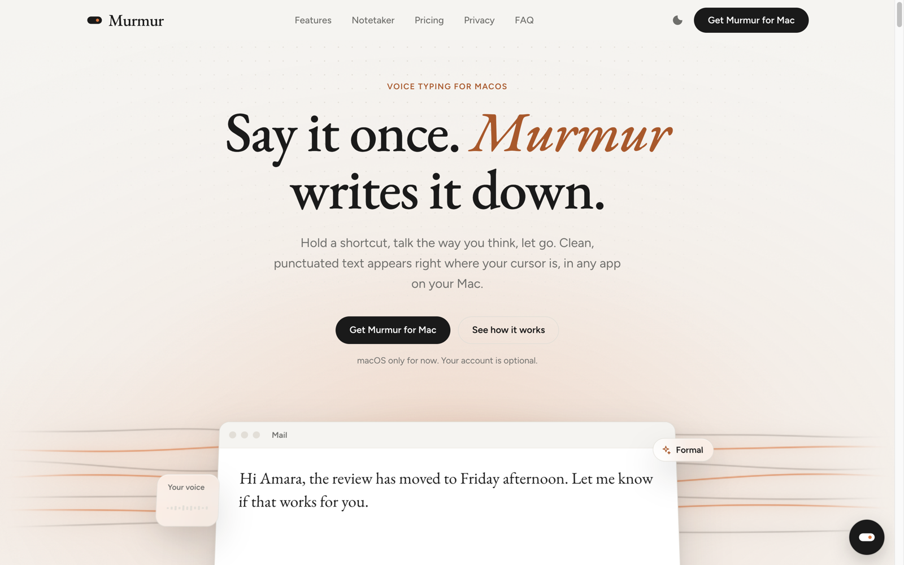
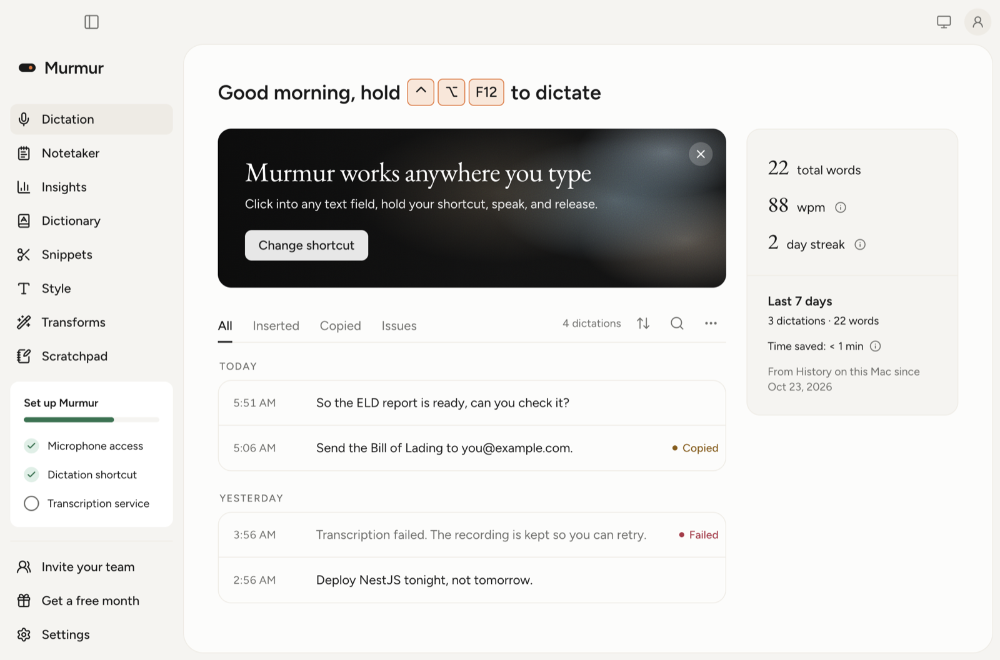
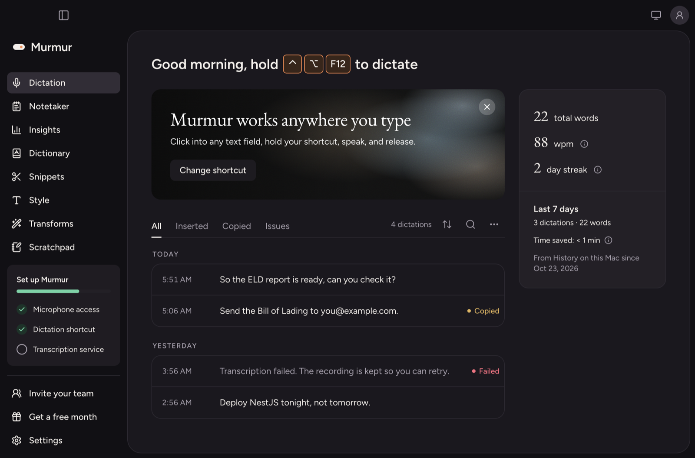
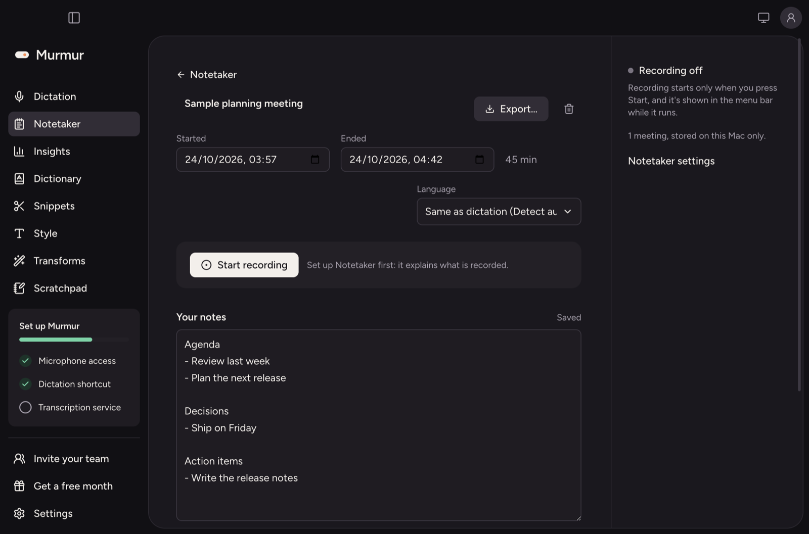
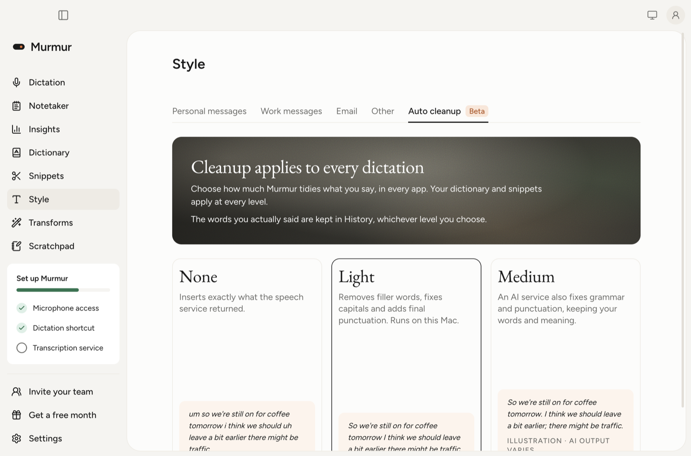
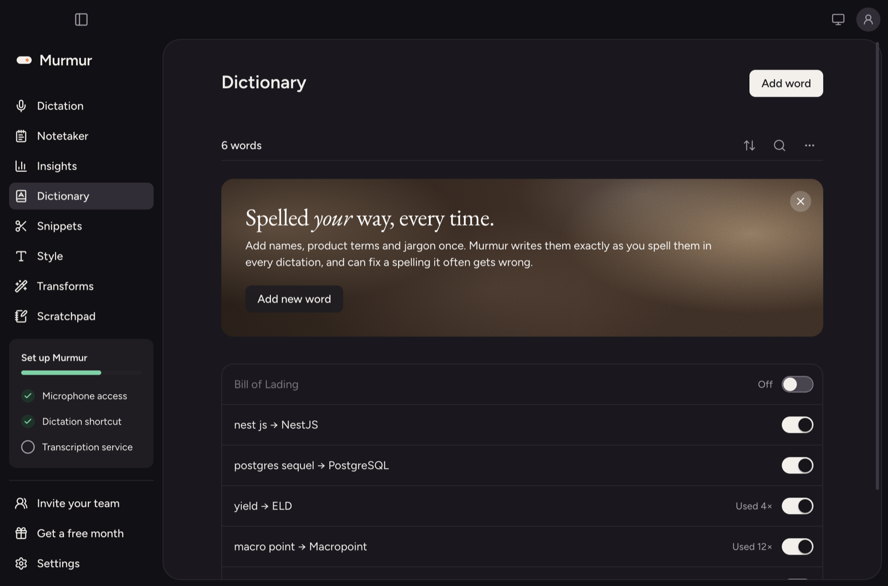
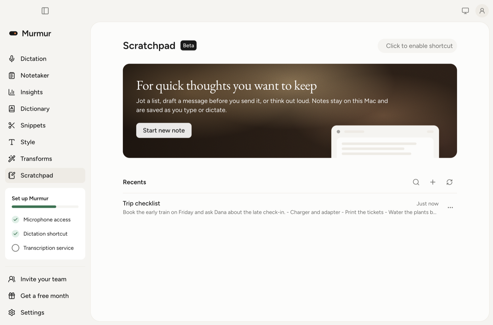
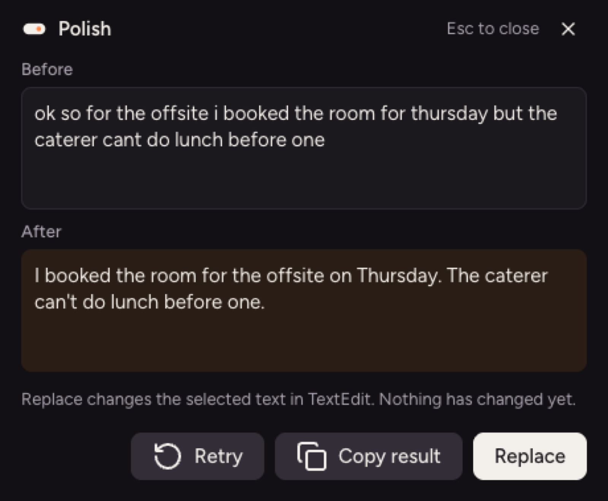
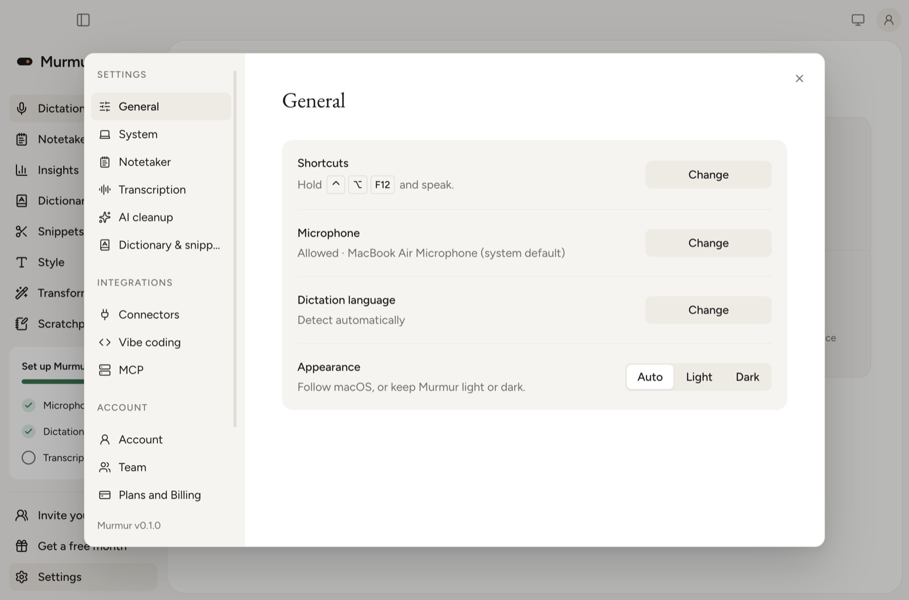
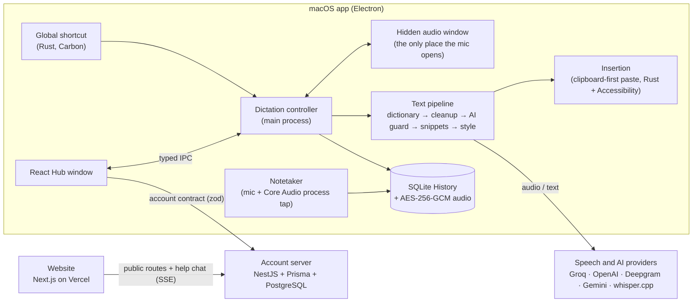

# Murmur: AI voice dictation for macOS

**Hold a shortcut, speak, let go: clean, punctuated text appears wherever your cursor is, in any app on your Mac.**

Murmur is a full product built end to end:

- a native macOS app (Electron + React + Rust);
- an account server (NestJS + PostgreSQL);
- a marketing website with an AI help chat (Next.js).

Live website: **https://murmur-six-zeta.vercel.app** · Case study: **[docs/CASE_STUDY.md](docs/CASE_STUDY.md)** · Hardest problem: **[a two-source realtime audio pipeline](#the-hardest-problem-a-two-source-realtime-audio-pipeline)**



## The app

| Dictation home and History                        | Dark theme                                             |
| ------------------------------------------------- | ------------------------------------------------------ |
|  |  |

| Notetaker                                                        | Writing style and cleanup                             |
| ---------------------------------------------------------------- | ----------------------------------------------------- |
|  |  |

| Personal dictionary                                | Scratchpad                                          |
| -------------------------------------------------- | --------------------------------------------------- |
|  |  |

| Transforms: rewrite selected text in any app                  | Settings                                                |
| ------------------------------------------------------------- | ------------------------------------------------------- |
|  |  |

_All screenshots use throwaway sample data generated by the app's own capture tool (`npm run capture -w apps/desktop`)._

## The hardest problem: a two-source realtime audio pipeline

The Notetaker records a call on a Mac (Zoom, Meet, anything) and turns it into a transcript that says who spoke:

```
You: Can we move the launch to Thursday?
Others: Thursday works, but the pricing page isn't ready yet.
```

To do that it captures two live audio streams at once: the **microphone** and **what the Mac plays**, which is the other people on the call.

### Why it was hard

- **Two sources with two clocks.**
  - The microphone arrives from a Chromium renderer over IPC.
  - The Mac's sound comes from a Core Audio process tap, in Rust, on Core Audio's realtime I/O thread.
  - They start at different moments and deliver at different rates. Either one can stall, or stop: switching to headphones changes the output device under the tap.
- **A realtime thread has strict rules.** The Core Audio callback may not allocate memory or wait for a lock, or the Mac's audio glitches.
- **The permission prompt blocks.** The first start waits until the person answers macOS's "System Audio Recording" prompt, which would freeze the app.
- **Who is speaking?**
  - Diarization models are slow, cost money and make mistakes.
  - Without headphones, the microphone also hears the speakers, so every remote sentence appears twice.
- **Meetings are long.**
  - An hour of audio must survive a crash, a network failure or a provider's request limit without starting over.
  - Nothing may leave the Mac except the audio sent to the transcription service.

### How I approached it: simple solutions over clever ones

- **One format at the edge.** Rust downmixes the tap to mono and decimates it to 16 kHz PCM16 with a box filter. That is the format the microphone already delivers, so everything after this point works on plain arrays.
- **Align by sample count, not timestamps.**
  - Each source fills its own FIFO queue.
  - Every 250 ms the recorder takes the amount both queues have.
  - When one source falls more than a second behind, its gap is filled with silence.
  - No clock synchronisation is needed. ([`recorder.ts`](apps/desktop/src/main/notetaker/recorder.ts))
- **Keep the realtime thread dumb.**
  - The callback writes into a preallocated buffer, using `try_lock`.
  - If JavaScript is reading at that instant, the block is dropped and counted instead of waiting.
  - `start()` runs on a worker thread and resolves a promise, so the permission prompt never freezes the UI. ([`sysaudio.rs`](native/crates/murmur-native/src/macos/sysaudio.rs))
- **Know the speaker from the source instead of guessing it.**
  - The microphone and the Mac's sound are saved as separate tracks: the microphone is "You" and the Mac is "Others".
  - Each track is transcribed with timestamps, and the two are merged in time order.
- **Remove echo on the text, not the audio.**
  - A microphone line is dropped as echo when at least 60% of its words repeat what "Others" said within half a second, in the same order (the longest common run of words).
  - This takes about 100 lines ([`speakers.ts`](apps/desktop/src/main/notetaker/speakers.ts)) instead of acoustic echo cancellation.
- **Durable by design.**
  - Audio is written as encrypted 30-second parts, so a crash loses at most 30 seconds.
  - Transcription runs in five-minute batches, and each batch is saved as it finishes, so a retry resumes where it stopped.
  - Silent batches are never sent.
  - The audio is deleted once the transcript is saved.

**Results:**

- The Notetaker has 30 automated tests ([`notetaker.test.ts`](apps/desktop/test/notetaker.test.ts)).
- If the Mac's output device changes during a recording, the app detects it and says so instead of silently recording nothing.

### What I personally contributed

I built Murmur with an AI coding agent (Claude Code), which wrote most of the code. My part was the engineering direction and the verification:

- **Rules.**
  - Nothing records before Start, and the Mac's sound is requested only when the person clicks Allow.
  - Audio never leaves the Mac except for transcription.
  - A crash may lose seconds, not the meeting.
- **Stages.** I split the work into three stages (notes, recording, speaker labels) and reviewed and approved each one before the next.
- **Testing.** I tested on my own Mac and confirmed by ear that the Mac's sound was really captured.

More detail: [docs/CASE_STUDY.md](docs/CASE_STUDY.md).

## Features

- **Dictation anywhere:**
  - push-to-talk or hands-free from a global shortcut, with a floating status Capsule;
  - transcription through Groq, OpenAI, Deepgram, Google Gemini or a local whisper.cpp server;
  - text pasted at the cursor, with the clipboard put back afterwards.
- **Cleanup that keeps your words:**
  - deterministic cleanup of fillers, repetitions and punctuation;
  - optional AI cleanup behind prompt-injection guards;
  - a personal dictionary, spoken snippets, and writing styles per app (formal for email, casual for chat).
- **History:** local search, a raw-versus-cleaned view, retry from encrypted audio, playback, retention rules and export.
- **Notetaker:** records the microphone together with the Mac's own sound, labels "You" and "Others", and writes transcripts and summaries.
- **Transforms:** rewrite the selected text in any app with saved AI prompts on their own shortcuts. You review the result before anything is replaced.
- **Scratchpad:** a floating note window that takes dictation directly, with autosave and revisions.
- **Integrations:** a local MCP server so AI assistants can read meeting notes, macOS Calendar reminders, and helpers for code editors.
- **Accounts:** sign-in by emailed code, teams and invites, referrals, and plans and billing.
- **Website:** a WebGL hero, scroll-driven storytelling, light and dark themes, a waitlist and a streaming AI help chat.

## Architecture



| Layer           | Technology                                                                                  |
| --------------- | ------------------------------------------------------------------------------------------- |
| Desktop app     | Electron, React, TypeScript, Tailwind, Radix UI                                             |
| Native layer    | Rust + napi-rs: global shortcuts, permissions, clipboard, insertion, system audio, Calendar |
| Text pipeline   | TypeScript packages: cleanup, dictionary, snippets, guarded AI cleanup and its eval suite   |
| Server          | NestJS, Prisma 7, PostgreSQL 17, server-sent events                                         |
| Website         | Next.js 16 (App Router), Tailwind 4, GSAP, WebGL                                            |
| Shared contract | zod schemas used by the app, the server and the website                                     |
| Quality         | Node test runner, Rust tests, Electron smoke test, axe-core accessibility checks            |

## Engineering highlights

- **Fast:** shortcut press → microphone open in 176 ms (p50, warm); status Capsule repaint in 20 ms; release → text ready in 3 ms, not counting the network call. All are measured by a latency harness in the repo.
- **Safe insertion:**
  - re-checks the target app and field before pasting;
  - never pastes into password fields;
  - falls back to copying when it isn't sure.
- **AI output treated as untrusted:**
  - dictated instructions are typed, not obeyed;
  - outputs that answer, translate, or drop a negation or a number are rejected;
  - models must pass an evaluation suite first (Groq `gpt-oss-120b`: 0.97, 0 instructions obeyed).
- **Private by default:**
  - History, recordings and notes stay on the Mac;
  - keys are kept in the macOS Keychain and recordings are encrypted with AES-256-GCM;
  - the server never receives any text, only a daily word count.
- **Hardened packaging:** hardened runtime, locked-down Electron fuses, IPC limited to the window that needs it, and loopback-only local servers.
- **Tested:**
  - over 900 automated tests across the app, server, website and packages, plus Rust tests;
  - an Electron smoke test that drives the real app;
  - WCAG 2.1 AA accessibility checks with 0 violations;
  - a release verification script (signing, entitlements, fuses, DMG integrity).

## Repository layout

```
apps/desktop/         Electron app: main process, preloads, Capsule / audio / Hub renderers, tests, smoke test
apps/server/          Account server (NestJS + Prisma): accounts, teams, referrals, billing, public routes, help chat
apps/web/             Marketing website (Next.js) with the help chat widget
packages/account-api/ Shared contract (zod) between the app, the server and the website
packages/speech/      Transcription provider interface and adapters
packages/text/        Deterministic cleanup, styles and word counting
packages/refine/      Transcript pipeline, guarded AI cleanup, evaluation suite
native/               Rust + napi-rs macOS addon and its tests
docs/                 Architecture, requirements, test strategy and stage reports
```

## Download

A test build for Apple Silicon Macs (M1 or newer) is on the **[Releases page](https://github.com/jaloliddinrakhmatov/murmur/releases)**. It isn't signed with an Apple Developer ID yet, so macOS asks you to allow it once:

1. Open the DMG and drag **Murmur** into **Applications**.
2. Open Murmur, click **Done** on the warning, then go to **System Settings → Privacy & Security** and click **Open Anyway**.
3. If macOS says the app "is damaged", run `xattr -dr com.apple.quarantine /Applications/Murmur.app` once.
4. Follow the setup. Transcription needs your own API key, for example a free Groq key.

## Running it locally

Requirements:

- an Apple Silicon Mac with macOS 13 or later;
- Node.js 24;
- the Rust toolchain;
- the Xcode Command Line Tools;
- an API key for a transcription service, for example a free Groq key.

```bash
npm install                          # all workspaces
source ~/.cargo/env && npm run build:native
npm start --workspace apps/desktop   # build and launch the app (npm run dev for hot reload)
```

The first launch walks you through the microphone permission, the shortcut (default `⌃⌥Space`) and the transcription service.

Optional parts:

```bash
npm run db:start -w apps/server && npm run db:migrate -w apps/server
MURMUR_DEV_OUTBOX=1 npm run dev -w apps/server   # account server on 127.0.0.1:4000
npm run dev -w apps/web                          # website on localhost:3000
```

Checks:

```bash
npm test             # every workspace, including Rust
npm run typecheck
npm run smoke        # drives the real Electron app
```

## Status

- **Working:** the app, the server and the website.
- **Installers:** test builds are produced with `npm run release -w apps/desktop -- --adhoc`. A public release needs Apple Developer ID signing and notarization.
- **Server:** runs locally for now.

## License

All rights reserved. The source is shared for portfolio review. Fonts (EB Garamond, Figtree) are under the SIL Open Font License; their licence files ship next to them.
